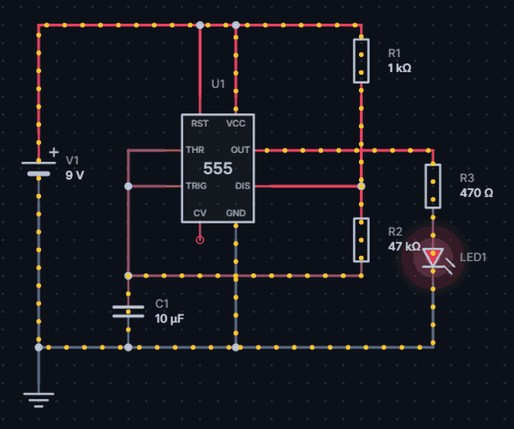
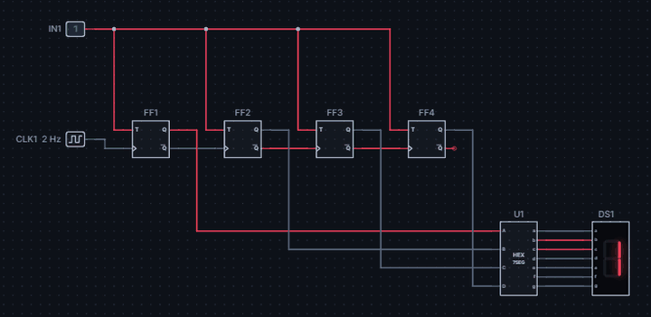
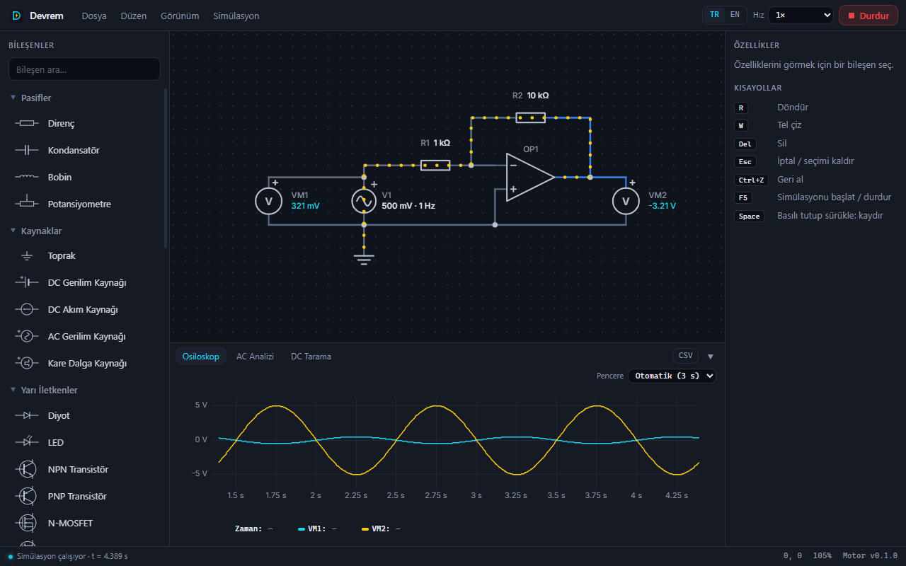
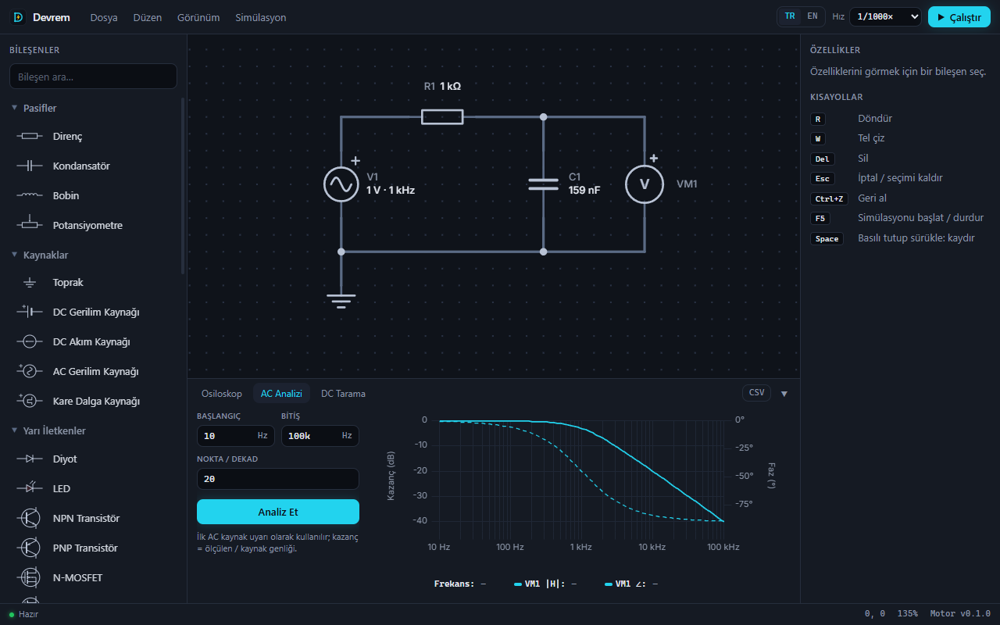
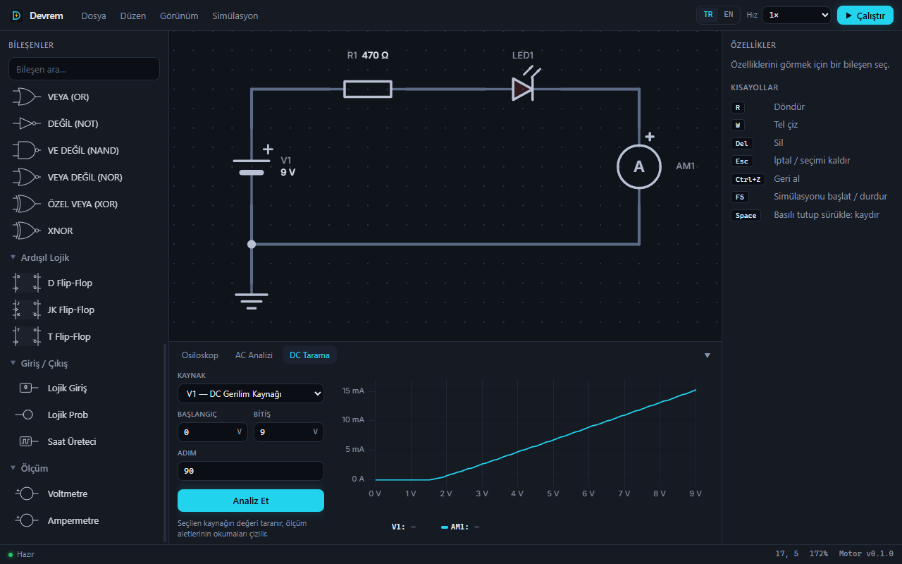
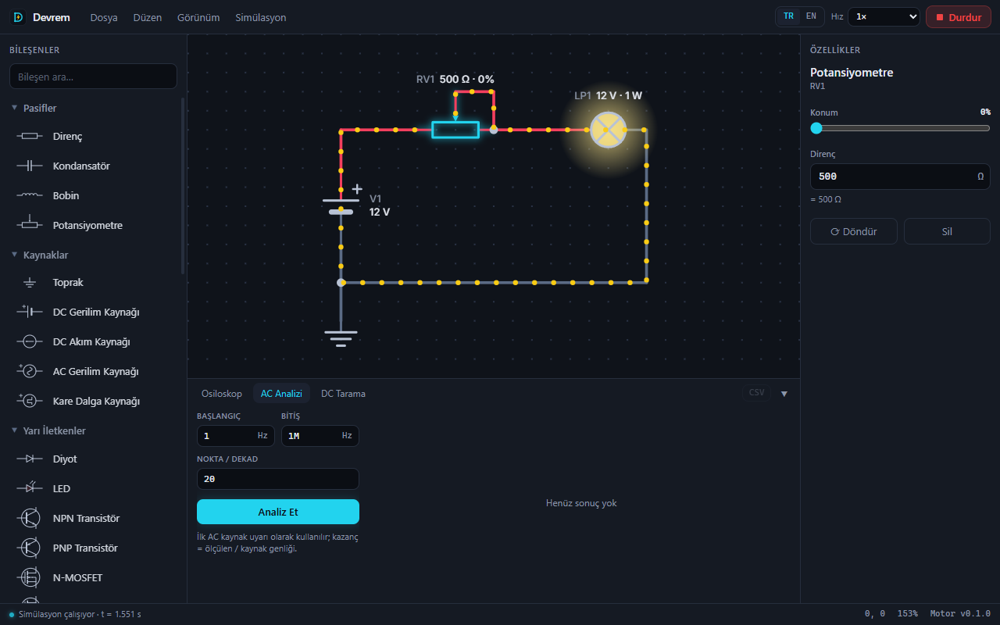
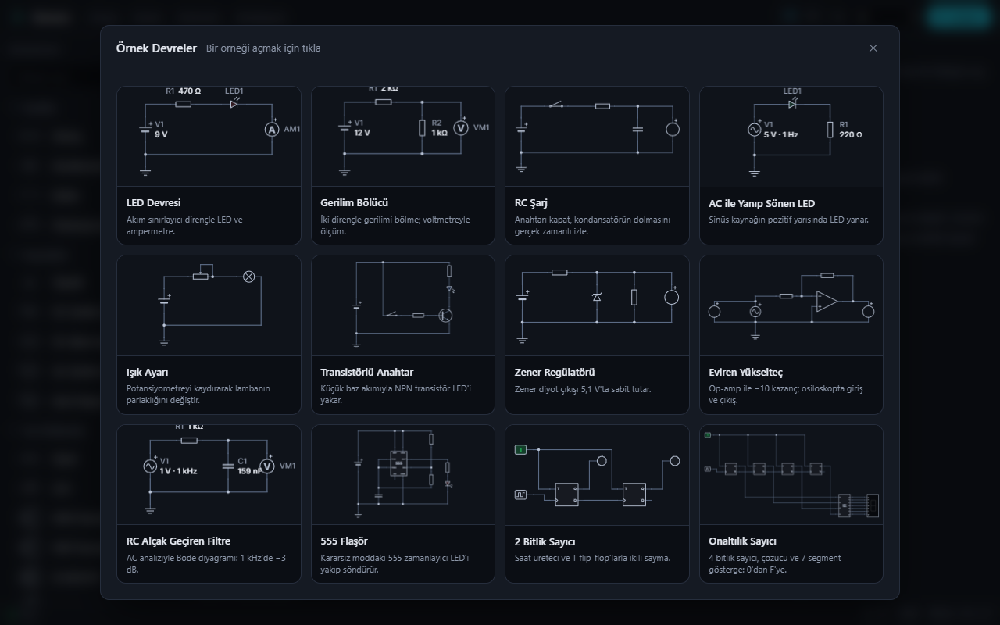
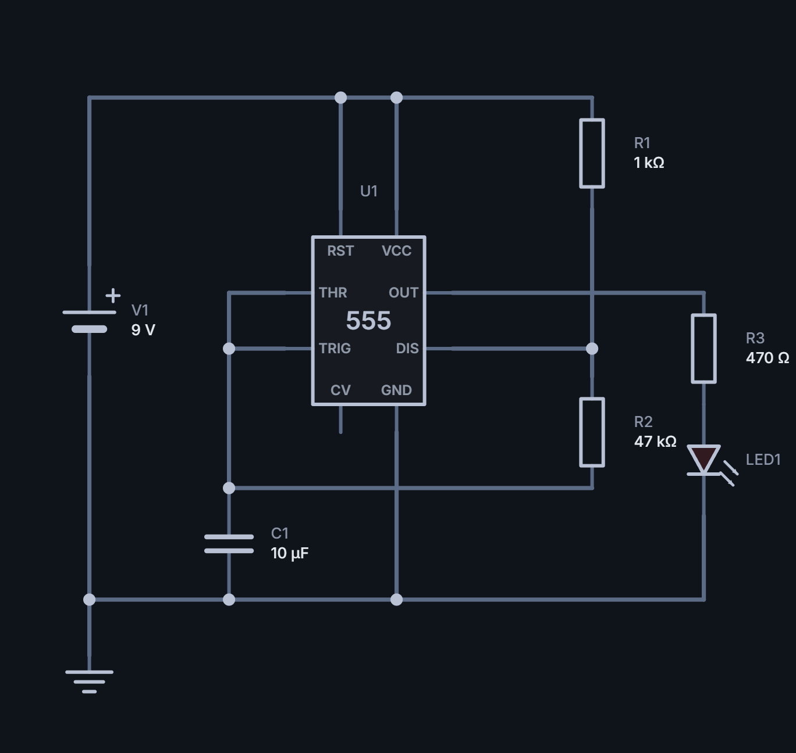
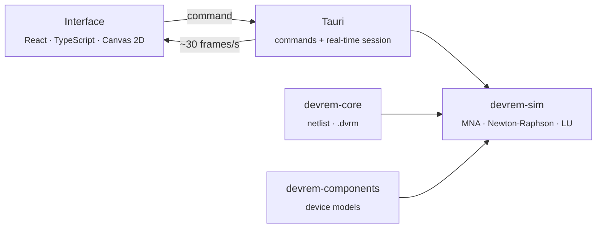

<div align="center">


# Devrem

**A modern, fast and free electronic circuit simulator**

Draw your circuit, run it, watch the current flow.

[🇹🇷 Türkçe](README.md) · **🇬🇧 English**

[](LICENSE)


[**💻 Installation**](#-installation) ·
[Features](#-highlights) ·
[Quick Start](#-quick-start) ·
[Development](#-development) ·
[Architecture](docs/ARCHITECTURE.md) ·
[Contribute](#-contributing)

<br />



<sub>An LED blinking with a 555 timer — real-time simulation</sub>

</div>

---

## What is Devrem?

Devrem is a desktop application that simulates analog and digital circuits **in
real time**. Its simulation engine was written from scratch in **Rust**; the
interface is dark, clean and available in English and Turkish.

Change a value and see the result instantly: wires are colored by voltage,
current flows as moving dots, LEDs glow and the oscilloscope draws the waveforms.

|                  |                                                         |
| ---------------- | ------------------------------------------------------- |
| 🎓 **Students**  | Learn by seeing and experimenting                       |
| 🔧 **Hobbyists** | Try a circuit virtually before building it              |
| 👩‍🏫 **Teachers**  | Live demos in class; share `.dvrm` files with students  |
| 👨‍🔬 **Engineers** | Quick experiments, AC analysis, DC sweeps, SPICE export |

**Why Devrem?**

- 🆓 **Free, no account, open source** — no sign-up, subscription or ads; MIT licensed.
- ⚡ **Real time** — click switches and drag potentiometers while it runs; the circuit state is kept.
- 🧠 **A verified engine** — an MNA-based solver checked by 81 tests against analytic results.
- 🔀 **Analog and digital together** — transistors, op-amps and the 555 work alongside logic gates and flip-flops in one circuit.
- 🪶 **Lightweight** — builds a ~4 MB installer and works fully offline.

---

## ✨ Highlights

<table>
  <tr>
    <td width="50%" valign="top">
      <h3>🔀 Analog + digital</h3>
      
      <p>A counter that goes from 0 to F with a clock, flip-flops, a hex decoder and a 7-segment display.</p>
    </td>
    <td width="50%" valign="top">
      <h3>📈 Live oscilloscope</h3>
      
      <p>Voltmeter, ammeter and logic probe readings are plotted live while the simulation runs.</p>
    </td>
  </tr>
  <tr>
    <td width="50%" valign="top">
      <h3>〰️ AC analysis (Bode)</h3>
      
      <p>Frequency response: gain (dB) and phase (°). An RC filter shows −3 dB and −45° at 1 kHz.</p>
    </td>
    <td width="50%" valign="top">
      <h3>📉 DC sweep</h3>
      
      <p>Sweep a source to get characteristic curves; export the data as CSV.</p>
    </td>
  </tr>
  <tr>
    <td width="50%" valign="top">
      <h3>🎛️ Live control</h3>
      
      <p>Drag a potentiometer, press a button, flip a switch — without restarting the simulation.</p>
    </td>
    <td width="50%" valign="top">
      <h3>🗂️ Example gallery</h3>
      
      <p>14 ready-made circuits, from an LED to a 555, a transformer and a hex counter. Open one and press F5.</p>
    </td>
  </tr>
</table>

<sub>Screenshots show the Turkish interface; the language can be switched to English from the toolbar.</sub>

### All features

<details open>
<summary><b>Schematic editor</b></summary>

- Place components by clicking or by dragging from the sidebar
- Draw wires from any pin with automatic L-shaped routing and T-junctions
- Select, box-select, move (connected wires stretch to follow), rotate
- Undo / redo, zoom, pan, fit circuit to screen
- SI-prefixed values: `4k7`, `100n`, `2.2µ`, `4,7k`
- Unconnected pins and invalid values are flagged instantly

</details>

<details>
<summary><b>Simulation and visualization</b></summary>

- Real-time transient simulation with adjustable speed (1× … 1/100000×)
- DC operating point, AC analysis (Bode), DC sweep
- Wires colored by voltage, moving dots showing current direction and magnitude
- Glowing LEDs and lamps, 7-segment displays, logic probes
- Hover a wire or pin to see its voltage
- Clear error messages: no ground, short circuit, invalid value…

</details>

<details>
<summary><b>Files and export</b></summary>

- `.dvrm` project files (readable JSON, version-control friendly)
- SPICE netlist (`.cir`), PNG, SVG and CSV export
- English and Turkish interface
- Automatic updates (via GitHub Releases)

</details>

---

## 💻 Installation

> [!IMPORTANT]
> No prebuilt installer (`.exe`) is published at the moment. You install
> Devrem by **building it from source** yourself. The steps below are written
> for someone with no programming experience. The first setup takes about
> **20–30 minutes**, including downloads and the first build.

### 1. Install the required tools _(once)_

| #   | Tool                          | Where                                                                                                                         | Note                                                                       |
| --- | ----------------------------- | ----------------------------------------------------------------------------------------------------------------------------- | -------------------------------------------------------------------------- |
| 1   | **Git**                       | [git-scm.com/download/win](https://git-scm.com/download/win)                                                                  | Install with the default options                                           |
| 2   | **Visual Studio Build Tools** | [visualstudio.microsoft.com/visual-cpp-build-tools](https://visualstudio.microsoft.com/visual-cpp-build-tools/)               | Select the **"Desktop development with C++"** workload during installation |
| 3   | **Rust**                      | [rustup.rs](https://rustup.rs/) → `rustup-init.exe`                                                                           | Choose `1` (default installation) in the window that opens                 |
| 4   | **Node.js**                   | [nodejs.org](https://nodejs.org/) → the **LTS** version                                                                       | Version 20 or later                                                        |
| 5   | **WebView2**                  | Preinstalled on Windows 11. On Windows 10: [Evergreen Bootstrapper](https://developer.microsoft.com/microsoft-edge/webview2/) | Already present on most Windows 10 systems                                 |

Then open a **new terminal** (Start → "PowerShell") and install pnpm:

```powershell
npm install -g pnpm
```

Check that everything is installed; each command should print a version number:

```powershell
git --version
rustc --version
node --version
pnpm --version
```

### 2. Get the source code

```powershell
git clone https://github.com/hamzashn/Devrem.git
cd Devrem
pnpm install
```

> [!TIP]
> If you'd rather not use Git, choose **Code → Download ZIP** on GitHub,
> extract it, open a terminal in that folder and run `pnpm install`.

### 3. Run it or build an installer

**To try it right away:**

```powershell
pnpm dev
```

The first launch takes a few minutes because the Rust code is compiled; later
launches are fast.

**To install it permanently:**

```powershell
pnpm build
```

When the build finishes (5–15 minutes the first time), these files are created:

| File                                                    | Purpose                                                            |
| ------------------------------------------------------- | ------------------------------------------------------------------ |
| `target\release\bundle\nsis\Devrem_0.1.0_x64-setup.exe` | **Installer** — double-click it; Devrem is added to the Start menu |
| `target\release\bundle\msi\Devrem_0.1.0_x64_en-US.msi`  | An MSI package of the same app                                     |
| `target\release\devrem-desktop.exe`                     | The program itself, runs without installing                        |

### Updating

To get the latest changes, run this in the project folder:

```powershell
git pull
pnpm install
pnpm build
```

Then run the new installer; it installs over the previous version.

<details>
<summary><b>Troubleshooting</b></summary>

| Error / symptom                                | Fix                                                                                                     |
| ---------------------------------------------- | ------------------------------------------------------------------------------------------------------- |
| `linker 'link.exe' not found`                  | The C++ workload is missing. Add it via **Visual Studio Installer → Modify**, then reopen the terminal. |
| `'pnpm' is not recognized` / `rustc` not found | Close and reopen the terminal after installing the tools.                                               |
| The first build takes a long time              | Normal; hundreds of Rust crates are compiled once. Later builds are much faster.                        |
| The window doesn't open or is blank            | Install WebView2 (tool 5 in step 1).                                                                    |
| Very slow build / antivirus warning            | Excluding the project folder from antivirus scanning speeds up builds.                                  |
| Not enough disk space                          | Rust build files (the `target` folder) need **5–10 GB** of free space.                                  |

If you're stuck, open an [issue](../../issues) with the error message.

</details>

---

## 🚀 Quick Start

1. **Place components** — pick one from the list on the left and click the canvas. `R` rotates, `Esc` stops.
2. **Draw wires** — click a pin, keep clicking for corners; the wire ends when you click another pin or wire.
3. **Add ground** — analog circuits need a **Ground** symbol.
4. **Run** — press `F5`. Click switches, drag potentiometers, watch the meters.
5. **Analyze** — use the **Oscilloscope**, **AC Analysis** and **DC Sweep** tabs in the bottom panel.

> [!TIP]
> To try it right away, open a circuit from **File → Example Circuits…** and press `F5`.

<details>
<summary><b>Keyboard shortcuts</b></summary>

| Shortcut                       | Action                     |
| ------------------------------ | -------------------------- |
| `F5`                           | Start / stop simulation    |
| `R`                            | Rotate                     |
| `W`                            | Start a wire at the cursor |
| `Del`                          | Delete                     |
| `Esc`                          | Cancel / deselect          |
| `Ctrl+Z` / `Ctrl+Y`            | Undo / redo                |
| `Ctrl+A`                       | Select all                 |
| `Ctrl+N` / `Ctrl+O` / `Ctrl+S` | New / open / save          |
| `Ctrl+0`                       | Fit circuit to screen      |
| Wheel · `Space`+drag           | Zoom · pan                 |

</details>

<details>
<summary><b>Writing values</b></summary>

| Input                 | Value              |
| --------------------- | ------------------ |
| `4k7`, `4.7k`, `4,7k` | 4.7 kΩ             |
| `100n`                | 100 nF             |
| `2.2µ`, `2.2u`        | 2.2 µ              |
| `1M` / `1meg`         | 1 mega             |
| `1m`                  | 1 milli            |
| `10kΩ`, `5V`, `50Hz`  | units are optional |

</details>

---

## 🧩 Components

**41 components** in nine categories:

| Category           | Components                                                                     |
| ------------------ | ------------------------------------------------------------------------------ |
| **Passives**       | Resistor · capacitor · inductor · potentiometer · transformer                  |
| **Sources**        | DC voltage · DC current · AC (sine) · pulse · ground                           |
| **Semiconductors** | Diode · LED (5 colors) · zener · NPN · PNP · N-MOSFET · P-MOSFET · optocoupler |
| **Integrated**     | Op-amp · 555 timer                                                             |
| **Switches**       | Switch · push button · SPDT switch                                             |
| **Logic gates**    | AND · OR · NOT · NAND · NOR · XOR · XNOR · hex → 7-segment decoder             |
| **Sequential**     | D · JK · T flip-flop                                                           |
| **Input / output** | Logic input · logic probe · clock · lamp · 7-segment display                   |
| **Measurement**    | Voltmeter · ammeter                                                            |

## 📊 Analyses

| Analysis               | What it does                                                                    |
| ---------------------- | ------------------------------------------------------------------------------- |
| **Real time**          | The circuit runs continuously; changes apply instantly, interactions keep state |
| **DC operating point** | All node voltages and currents (steady state)                                   |
| **AC analysis**        | Frequency sweep; gain (dB) and phase (°) — Bode plot                            |
| **DC sweep**           | Sweeps a source and plots the meter readings                                    |
| **Oscilloscope**       | Meter readings over time; adjustable time window                                |

## 🗂️ Example Circuits

In the [`examples/`](examples/) folder and the in-app gallery:

| Example                                                 | Shows                                  |
| ------------------------------------------------------- | -------------------------------------- |
| [LED Circuit](examples/led.dvrm)                        | Current-limiting resistor, ammeter     |
| [Voltage Divider](examples/gerilim-bolucu.dvrm)         | Dividing a voltage with two resistors  |
| [RC Charging](examples/rc-sarj.dvrm)                    | A capacitor charging in real time      |
| [AC Blinking LED](examples/ac-led.dvrm)                 | Half-wave of a sine source             |
| [Light Dimmer](examples/isik-ayari.dvrm)                | Live brightness with a potentiometer   |
| [Transistor Switch](examples/transistor-anahtar.dvrm)   | Driving an LED with an NPN transistor  |
| [Zener Regulator](examples/zener-regulator.dvrm)        | A steady 5.1 V output                  |
| [Transformer](examples/transformator.dvrm)              | 2:1 step-down, isolated secondary      |
| [Optocoupler Isolation](examples/optokuplor.dvrm)       | A signal between two isolated circuits |
| [Inverting Amplifier](examples/evirici-yukselteci.dvrm) | Op-amp, gain of −10, oscilloscope      |
| [RC Low-Pass Filter](examples/rc-alcak-geciren.dvrm)    | AC analysis, Bode plot                 |
| [555 Flasher](examples/555-flasor.dvrm)                 | An astable 555                         |
| [2-Bit Counter](examples/sayici.dvrm)                   | Binary counting with T flip-flops      |
| [Hex Counter](examples/hex-sayac.dvrm)                  | Decoder and 7-segment display          |

<details>
<summary><b>An exported schematic (PNG)</b></summary>
<br />

</details>

---

## 🧑‍💻 Development

The tools from the [Installation](#-installation) section are all you need to
contribute or change the code.

```bash
# Run the app in development mode (changes apply instantly)
pnpm dev

# Tests and checks
cargo test --workspace
cargo clippy --workspace --all-targets -- -D warnings
pnpm typecheck && pnpm lint && pnpm format:check

# Installer (NSIS + MSI)
pnpm build

# Website (http://localhost:3000)
pnpm --filter web dev
```

### Repository layout

```
crates/
  devrem-core/          Document, netlist, SI units, component kinds
  devrem-components/    Device models (diode, BJT, MOSFET, op-amp, logic, 555)
  devrem-sim/           MNA simulator, analyses, SPICE export
apps/
  desktop/              Tauri 2 + React desktop app
  web/                  Next.js website
packages/               Shared component definitions and design tokens
locales/                English and Turkish translations
examples/               Example circuits (.dvrm)
docs/                   Architecture, release process, images
```

---

## 🏗 Architecture



The schematic is turned into electrical nodes by the netlist builder, and each
component adds its contribution to the MNA matrix. Nonlinear components such as
diodes, transistors and op-amps are solved with Newton-Raphson; capacitors and
inductors are discretized with the trapezoidal method. Logic components live in
the same matrix, with inputs read against a voltage threshold and 0 / 5 V outputs.

Details (in Turkish): [**docs/ARCHITECTURE.md**](docs/ARCHITECTURE.md)

| Layer        | Technology                                                                |
| ------------ | ------------------------------------------------------------------------- |
| Engine       | Rust · serde · num-complex · thiserror · tracing                          |
| Desktop      | Tauri 2 (updater, dialog)                                                 |
| Interface    | React 19 · TypeScript · Vite · Zustand · Tailwind CSS 4 · uPlot · i18next |
| Website      | Next.js 16 (static export) · Tailwind CSS 4                               |
| CI / release | GitHub Actions · tauri-action                                             |

---

## 🗺 Roadmap

- [x] Schematic editor, real-time simulation, current animation
- [x] DC operating point, AC analysis, DC sweep, oscilloscope
- [x] Transistors, op-amp, 555, logic gates, flip-flops, 7-segment display
- [x] SPICE / PNG / SVG / CSV export, example gallery
- [x] Installer and automatic update infrastructure
- [ ] Publish a prebuilt installer (release)
- [ ] New components: transformer, controlled sources, relay, shift register
- [ ] Sparse solver for large circuits
- [ ] Copy / paste, subcircuits
- [ ] Windows code signing

Have an idea? Open an [issue](../../issues).

---

## 🤝 Contributing

Bug reports, suggestions and code contributions are welcome. Issues and pull
requests can be written in English or Turkish.

1. Open an [issue](../../issues) for a bug or an idea first.
2. Fork the repository, create a feature branch and use
   [Conventional Commits](https://www.conventionalcommits.org/)
   (`feat:`, `fix:`, `docs:` …).
3. Run the checks before submitting:

   ```bash
   cargo fmt --all -- --check
   cargo clippy --workspace --all-targets -- -D warnings
   cargo test --workspace
   pnpm typecheck && pnpm lint && pnpm format:check
   ```

4. Open a pull request.

To add a new component, start with [docs/ARCHITECTURE.md](docs/ARCHITECTURE.md).
The release process is in [docs/release.md](docs/release.md) and changes are in
[CHANGELOG.md](CHANGELOG.md) (both in Turkish).

By contributing, you agree that your contribution is released under the same
MIT license as the project.

---

## 🔒 Privacy

Devrem **needs no account and collects no data.** Circuits are stored only on
your computer as `.dvrm` files. The app's only network request is a check for a
new version on GitHub Releases at startup.

## 📄 License

[MIT](LICENSE) © 2026 HamzaShn

You may use, copy, modify and distribute Devrem for free; just keep the license
text and the copyright notice.

<div align="center">
<br />
<sub><b>Devrem</b> — Draw it, run it, understand it. ⚡</sub>
</div>
