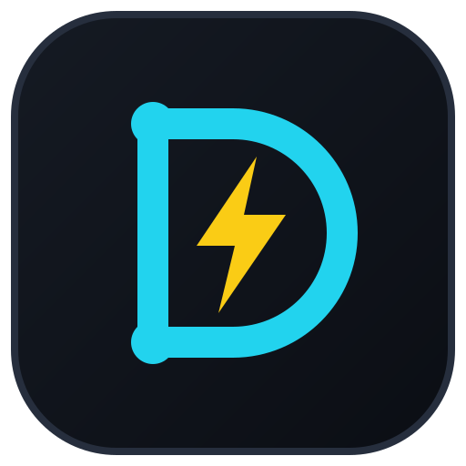
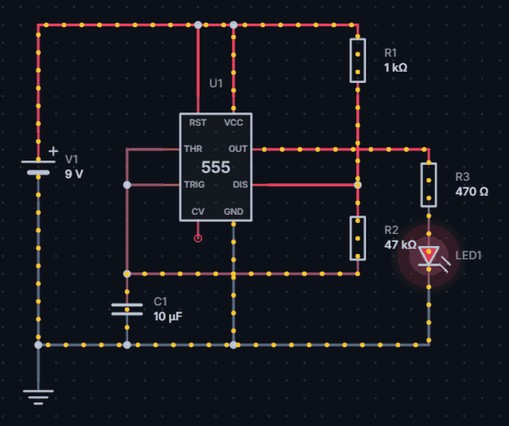
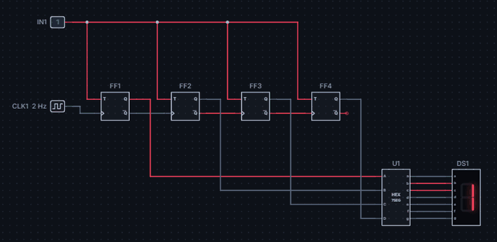
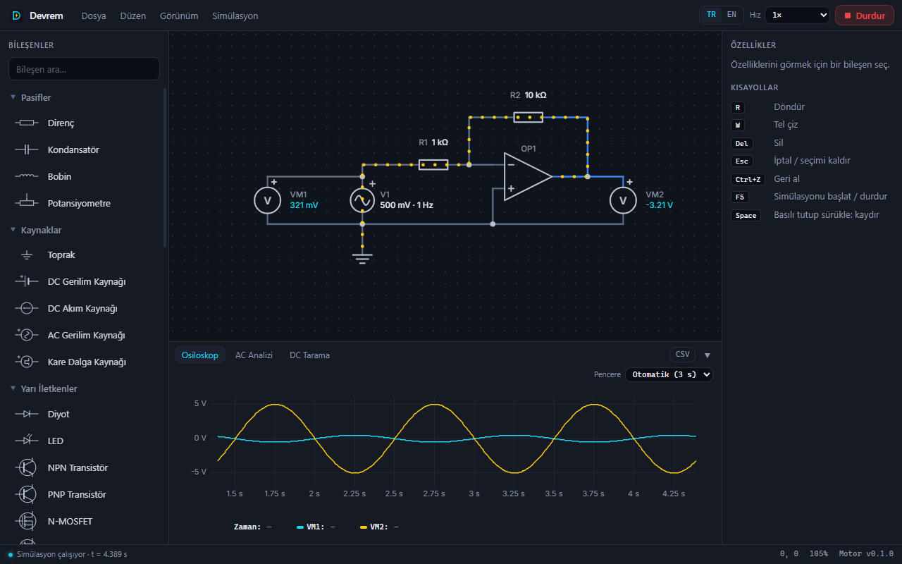
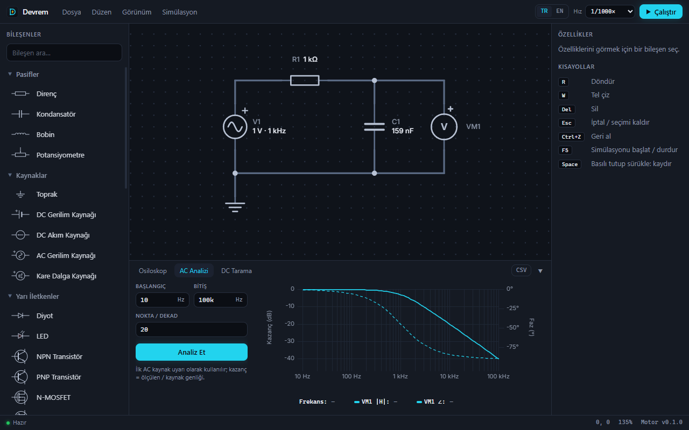
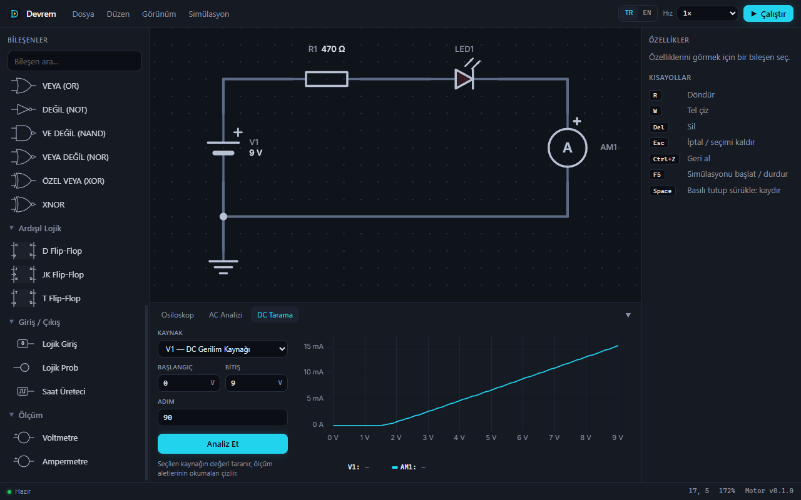
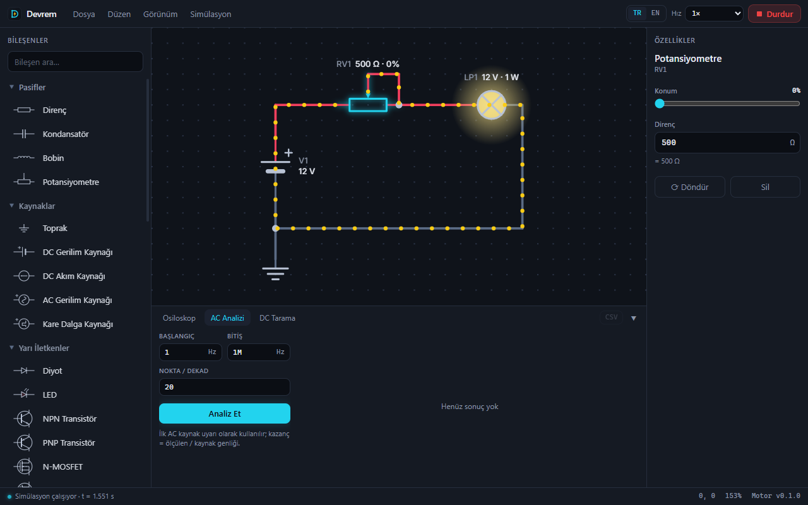
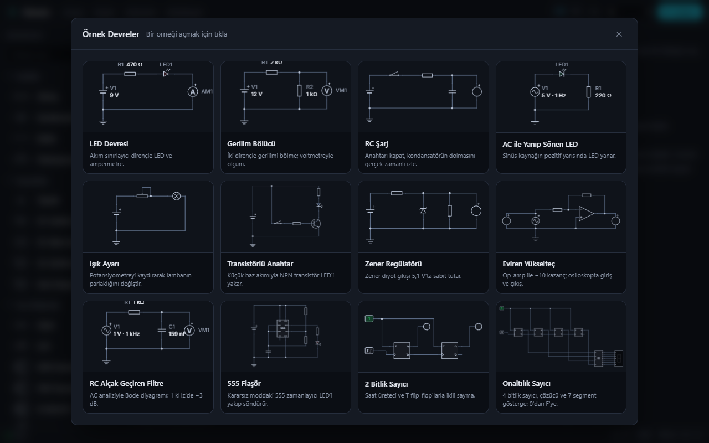
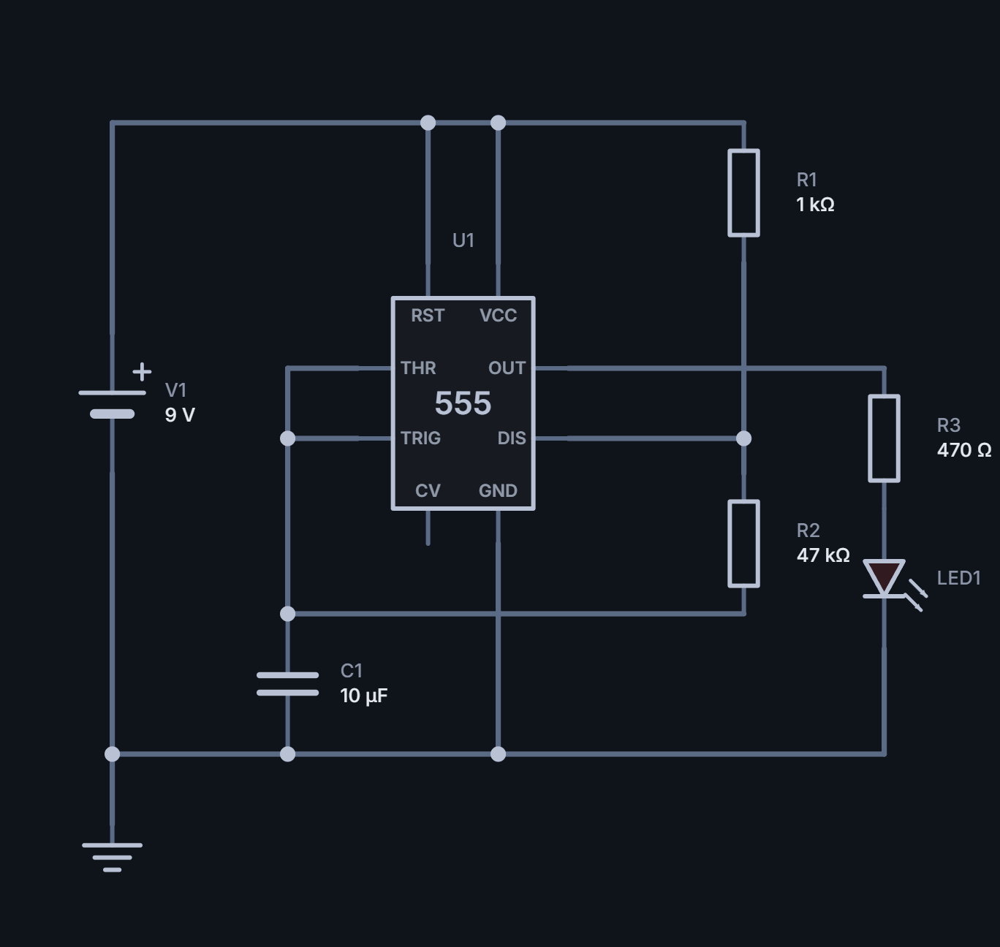
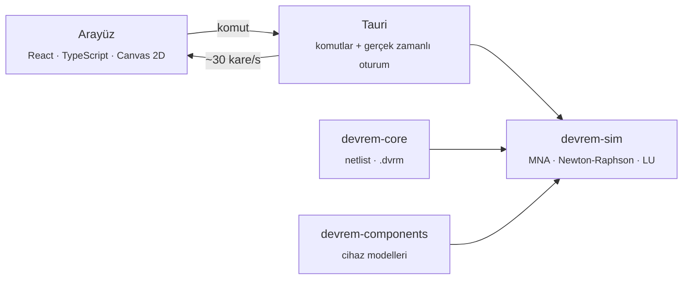

<div align="center">



# Devrem

**Modern, hızlı ve ücretsiz elektronik devre simülatörü**

Devreni çiz, çalıştır, akımın aktığını gör.

**🇹🇷 Türkçe** · [🇬🇧 English](README.en.md)

[](LICENSE)


[**💻 Kurulum**](#-kurulum) ·
[Özellikler](#-öne-çıkanlar) ·
[Hızlı Başlangıç](#-hızlı-başlangıç) ·
[Geliştirme](#-geliştirme) ·
[Mimari](docs/ARCHITECTURE.md) ·
[Katkıda Bulun](#-katkıda-bulunma)

<br />



<sub>555 zamanlayıcıyla yanıp sönen LED — gerçek zamanlı simülasyon</sub>

</div>

---

## Devrem nedir?

Devrem; analog ve dijital devreleri **gerçek zamanlı** simüle eden bir masaüstü
uygulamasıdır. Simülasyon motoru sıfırdan **Rust** ile yazıldı; arayüz koyu
temalı, sade ve Türkçe.

Bir değeri değiştirdiğinde sonucu anında görürsün: teller gerilime göre
renklenir, akım hareketli noktalarla akar, LED'ler parlar, osiloskop dalga
biçimlerini çizer.

|                    |                                                              |
| ------------------ | ------------------------------------------------------------ |
| 🎓 **Öğrenciler**  | Ders konularını görerek ve deneyerek öğrenmek                |
| 🔧 **Hobiciler**   | Devreyi kurmadan önce sanal ortamda denemek                  |
| 👩‍🏫 **Eğitmenler**  | Derste canlı devre gösterimi, öğrencilerle `.dvrm` paylaşımı |
| 👨‍🔬 **Mühendisler** | Hızlı fikir denemesi, AC analizi, DC tarama, SPICE çıktısı   |

**Neden Devrem?**

- 🆓 **Ücretsiz, hesapsız, açık kaynak** — kayıt, abonelik veya reklam yok; MIT lisanslı.
- ⚡ **Gerçek zamanlı** — simülasyon çalışırken anahtarlara tıkla, potansiyometreyi kaydır; devrenin durumu korunur.
- 🧠 **Doğrulanmış motor** — MNA tabanlı çözücü, analitik sonuçlarla karşılaştıran 81 testle sınanıyor.
- 🔀 **Analog ve dijital bir arada** — transistörler, op-amp ve 555 ile lojik kapılar ve flip-flop'lar aynı devrede çalışır.
- 🪶 **Hafif** — ~4 MB'lık kurulum dosyası üretir, tamamen çevrimdışı çalışır.

---

## ✨ Öne Çıkanlar

<table>
  <tr>
    <td width="50%" valign="top">
      <h3>🔀 Analog + dijital</h3>
      
      <p>Saat üreteci, flip-flop'lar, onaltılık çözücü ve 7 segment gösterge ile 0'dan F'ye sayan sayıcı.</p>
    </td>
    <td width="50%" valign="top">
      <h3>📈 Canlı osiloskop</h3>
      
      <p>Voltmetre, ampermetre ve lojik prob okumaları simülasyon sırasında canlı çizilir.</p>
    </td>
  </tr>
  <tr>
    <td width="50%" valign="top">
      <h3>〰️ AC analizi (Bode)</h3>
      
      <p>Frekans tepkisi: kazanç (dB) ve faz (°). RC filtrede 1 kHz'de −3 dB, −45°.</p>
    </td>
    <td width="50%" valign="top">
      <h3>📉 DC tarama</h3>
      
      <p>Bir kaynağın değerini tarayarak karakteristik eğri çıkar; verileri CSV olarak al.</p>
    </td>
  </tr>
  <tr>
    <td width="50%" valign="top">
      <h3>🎛️ Canlı kontrol</h3>
      
      <p>Potansiyometreyi kaydır, butona bas, anahtarı aç-kapat — simülasyon yeniden başlamadan.</p>
    </td>
    <td width="50%" valign="top">
      <h3>🗂️ Örnek galerisi</h3>
      
      <p>14 hazır devre: LED'den 555'e, transformatörden onaltılık sayıcıya. Tek tıkla aç, F5'e bas.</p>
    </td>
  </tr>
</table>

### Tüm özellikler

<details open>
<summary><b>Şema editörü</b></summary>

- Kenar çubuğundan tıklayarak veya sürükleyip bırakarak bileşen yerleştirme
- Pinden tel çekme, köşeleri otomatik L biçiminde yönlendirme, T bağlantıları
- Seçim, kutuyla seçim, taşıma (bağlı teller esneyerek takip eder), döndürme
- Geri al / yinele, yakınlaştırma, kaydırma, devreyi ekrana sığdırma
- SI önekli değerler: `4k7`, `100n`, `2.2µ`, `4,7k` (Türkçe ondalık virgül de olur)
- Boşta kalan pinlerin ve geçersiz değerlerin anında işaretlenmesi

</details>

<details>
<summary><b>Simülasyon ve görselleştirme</b></summary>

- Gerçek zamanlı geçici durum simülasyonu, ayarlanabilir hız (1× … 1/100000×)
- DC çalışma noktası, AC analizi (Bode), DC tarama
- Gerilime göre renklenen teller, akım yönü ve şiddetini gösteren hareketli noktalar
- Parlayan LED'ler ve lambalar, 7 segment gösterge, lojik problar
- Telin veya pinin üzerine gelince o noktanın gerilimi
- Anlaşılır hata mesajları: toprak yok, kısa devre, geçersiz değer…

</details>

<details>
<summary><b>Dosya ve dışa aktarma</b></summary>

- `.dvrm` proje dosyaları (okunabilir JSON, sürüm kontrolüne uygun)
- SPICE netlist (`.cir`), PNG, SVG ve CSV dışa aktarımı
- Türkçe ve İngilizce arayüz
- Otomatik güncelleme (GitHub Releases üzerinden)

</details>

---

## 💻 Kurulum

> [!IMPORTANT]
> Şu an hazır bir kurulum dosyası (`.exe`) yayımlanmıyor. Devrem'i kaynak
> koddan **kendin derleyerek** kurarsın. Aşağıdaki adımlar hiç programlama
> bilmeyen biri için de yazıldı. İlk kurulum, indirmeler ve ilk derleme dahil
> yaklaşık **20–30 dakika** sürer.

### 1. Gerekli araçları kur _(yalnızca bir kez)_

| #   | Araç                          | Nereden                                                                                                                      | Dikkat                                                                                           |
| --- | ----------------------------- | ---------------------------------------------------------------------------------------------------------------------------- | ------------------------------------------------------------------------------------------------ |
| 1   | **Git**                       | [git-scm.com/download/win](https://git-scm.com/download/win)                                                                 | Varsayılan seçeneklerle kur                                                                      |
| 2   | **Visual Studio Build Tools** | [visualstudio.microsoft.com/visual-cpp-build-tools](https://visualstudio.microsoft.com/visual-cpp-build-tools/)              | Kurulumda **"C++ ile masaüstü geliştirme"** (_Desktop development with C++_) seçeneğini işaretle |
| 3   | **Rust**                      | [rustup.rs](https://rustup.rs/) → `rustup-init.exe`                                                                          | Açılan pencerede `1` (varsayılan kurulum) seç                                                    |
| 4   | **Node.js**                   | [nodejs.org](https://nodejs.org/) → **LTS** sürümü                                                                           | Sürüm 20 veya üstü                                                                               |
| 5   | **WebView2**                  | Windows 11'de zaten yüklü. Windows 10'da: [Evergreen Bootstrapper](https://developer.microsoft.com/microsoft-edge/webview2/) | Çoğu Windows 10'da da yüklüdür                                                                   |

Ardından **yeni bir terminal** aç (Başlat → "PowerShell") ve pnpm'i kur:

```powershell
npm install -g pnpm
```

Her şeyin kurulduğunu kontrol et; her komut bir sürüm numarası yazmalı:

```powershell
git --version
rustc --version
node --version
pnpm --version
```

### 2. Kaynak kodu indir

```powershell
git clone https://github.com/hamzashn/Devrem.git
cd Devrem
pnpm install
```

> [!TIP]
> Git kullanmak istemezsen GitHub'da **Code → Download ZIP** ile indirip
> klasöre çıkar, sonra o klasörde terminal açıp `pnpm install` çalıştır.

### 3. Çalıştır veya kurulum dosyası oluştur

**Hemen denemek için:**

```powershell
pnpm dev
```

İlk seferde Rust kodu derlendiği için pencerenin açılması birkaç dakika sürer;
sonraki açılışlar hızlıdır.

**Kalıcı olarak kurmak için:**

```powershell
pnpm build
```

Derleme bitince (ilk seferde 5–15 dakika) şu dosyalar oluşur:

| Dosya                                                   | Ne işe yarar                                                     |
| ------------------------------------------------------- | ---------------------------------------------------------------- |
| `target\release\bundle\nsis\Devrem_0.1.0_x64-setup.exe` | **Kurulum dosyası** — çift tıkla, Devrem Başlat menüsüne eklenir |
| `target\release\bundle\msi\Devrem_0.1.0_x64_en-US.msi`  | Aynı uygulamanın MSI kurulum paketi                              |
| `target\release\devrem-desktop.exe`                     | Kurulum gerektirmeden doğrudan çalışan program                   |

### Güncelleme

Yeni değişiklikleri almak için proje klasöründe:

```powershell
git pull
pnpm install
pnpm build
```

Sonra yeni kurulum dosyasını çalıştırman yeterli; eski sürümün üzerine kurulur.

<details>
<summary><b>Sorun giderme</b></summary>

| Hata / belirti                                   | Çözüm                                                                                                     |
| ------------------------------------------------ | --------------------------------------------------------------------------------------------------------- |
| `linker 'link.exe' not found`                    | Build Tools'ta C++ seçeneği eksik. **Visual Studio Installer → Değiştir** ile ekle, terminali yeniden aç. |
| `'pnpm' is not recognized` / `rustc` bulunamıyor | Araçları kurduktan sonra terminali kapatıp yeniden aç.                                                    |
| İlk derleme çok uzun sürüyor                     | Normal; yüzlerce Rust paketi bir kez derlenir. Sonraki derlemeler çok daha hızlıdır.                      |
| Pencere açılmıyor veya boş görünüyor             | WebView2'yi yükle (1. adımdaki 5. araç).                                                                  |
| Derleme çok yavaş / antivirüs uyarısı            | Proje klasörünü antivirüs taramasının dışında bırakmak derlemeyi hızlandırır.                             |
| Disk alanı yetmiyor                              | Rust derleme dosyaları (`target` klasörü) için **5–10 GB** boş alan gerekir.                              |

Çözemediğin bir sorun olursa hata mesajıyla birlikte bir [issue](../../issues) aç.

</details>

---

## 🚀 Hızlı Başlangıç

1. **Bileşen yerleştir** — soldaki listeden bir bileşen seç ve tuvale tıkla. `R` ile döndür, `Esc` ile bitir.
2. **Tel çek** — bir pine tıkla, köşeler için tıklamaya devam et; başka bir pine veya tele tıklayınca tel biter.
3. **Toprak ekle** — analog devrelerde bir **Toprak** sembolü gerekir.
4. **Çalıştır** — `F5`'e bas. Anahtarlara tıkla, potansiyometreyi kaydır, ölçü aletlerini izle.
5. **Analiz et** — alt paneldeki **Osiloskop**, **AC Analizi** ve **DC Tarama** sekmelerini kullan.

> [!TIP]
> Hemen denemek için **Dosya → Örnek Devreler…** menüsünden bir devre aç ve `F5`'e bas.

<details>
<summary><b>Klavye kısayolları</b></summary>

| Kısayol                        | İşlev                       |
| ------------------------------ | --------------------------- |
| `F5`                           | Simülasyonu başlat / durdur |
| `R`                            | Döndür                      |
| `W`                            | İmleçten tel çizmeye başla  |
| `Del`                          | Sil                         |
| `Esc`                          | İptal / seçimi kaldır       |
| `Ctrl+Z` / `Ctrl+Y`            | Geri al / yinele            |
| `Ctrl+A`                       | Tümünü seç                  |
| `Ctrl+N` / `Ctrl+O` / `Ctrl+S` | Yeni / aç / kaydet          |
| `Ctrl+0`                       | Devreyi ekrana sığdır       |
| Tekerlek · `Boşluk`+sürükle    | Yakınlaştır · kaydır        |

</details>

<details>
<summary><b>Değer yazımı</b></summary>

| Yazım                 | Değer                      |
| --------------------- | -------------------------- |
| `4k7`, `4.7k`, `4,7k` | 4,7 kΩ                     |
| `100n`                | 100 nF                     |
| `2.2µ`, `2.2u`        | 2,2 µ                      |
| `1M` / `1meg`         | 1 mega                     |
| `1m`                  | 1 mili                     |
| `10kΩ`, `5V`, `50Hz`  | birim eklemek isteğe bağlı |

</details>

---

## 🧩 Bileşenler

**41 bileşen**, dokuz kategoride:

| Kategori            | Bileşenler                                                                  |
| ------------------- | --------------------------------------------------------------------------- |
| **Pasifler**        | Direnç · kondansatör · bobin · potansiyometre · transformatör               |
| **Kaynaklar**       | DC gerilim · DC akım · AC (sinüs) · kare dalga · toprak                     |
| **Yarı iletkenler** | Diyot · LED (5 renk) · zener · NPN · PNP · N-MOSFET · P-MOSFET · optokuplör |
| **Entegre**         | Op-amp · 555 zamanlayıcı                                                    |
| **Anahtarlar**      | Anahtar · buton · iki yollu (SPDT) anahtar                                  |
| **Lojik kapılar**   | AND · OR · NOT · NAND · NOR · XOR · XNOR · hex → 7 segment çözücü           |
| **Ardışıl lojik**   | D · JK · T flip-flop                                                        |
| **Giriş / çıkış**   | Lojik giriş · lojik prob · saat üreteci · lamba · 7 segment                 |
| **Ölçüm**           | Voltmetre · ampermetre                                                      |

## 📊 Analizler

| Analiz                 | Ne yapar                                                                      |
| ---------------------- | ----------------------------------------------------------------------------- |
| **Gerçek zamanlı**     | Devre sürekli çalışır; değişiklikler anında yansır, etkileşimler durumu korur |
| **DC çalışma noktası** | Tüm düğüm gerilimleri ve akımlar (durağan durum)                              |
| **AC analizi**         | Frekans taraması; kazanç (dB) ve faz (°) — Bode diyagramı                     |
| **DC tarama**          | Bir kaynağı tarayıp ölçü aletlerinin okumalarını çizer                        |
| **Osiloskop**          | Ölçü aletlerinin zamana göre değişimi; pencere süresi ayarlanabilir           |

## 🗂️ Örnek Devreler

[`examples/`](examples/) klasöründe ve uygulamadaki galeride:

| Örnek                                                     | Gösterdiği                           |
| --------------------------------------------------------- | ------------------------------------ |
| [LED Devresi](examples/led.dvrm)                          | Akım sınırlayıcı direnç, ampermetre  |
| [Gerilim Bölücü](examples/gerilim-bolucu.dvrm)            | İki dirençle gerilim bölme           |
| [RC Şarj](examples/rc-sarj.dvrm)                          | Kondansatörün gerçek zamanlı dolması |
| [AC ile Yanıp Sönen LED](examples/ac-led.dvrm)            | Sinüs kaynağın yarım dalgası         |
| [Işık Ayarı](examples/isik-ayari.dvrm)                    | Potansiyometreyle canlı parlaklık    |
| [Transistörlü Anahtar](examples/transistor-anahtar.dvrm)  | NPN transistörle LED sürme           |
| [Zener Regülatörü](examples/zener-regulator.dvrm)         | 5,1 V'ta sabit çıkış                 |
| [Transformatör](examples/transformator.dvrm)              | 2:1 düşürücü, yalıtılmış ikincil     |
| [Optokuplör ile Yalıtım](examples/optokuplor.dvrm)        | Yalıtılmış iki devre arasında sinyal |
| [Eviren Yükselteç](examples/evirici-yukselteci.dvrm)      | Op-amp, −10 kazanç, osiloskop        |
| [RC Alçak Geçiren Filtre](examples/rc-alcak-geciren.dvrm) | AC analizi, Bode diyagramı           |
| [555 Flaşör](examples/555-flasor.dvrm)                    | Kararsız (astable) 555               |
| [2 Bitlik Sayıcı](examples/sayici.dvrm)                   | T flip-flop'larla ikili sayma        |
| [Onaltılık Sayıcı](examples/hex-sayac.dvrm)               | Çözücü ve 7 segment gösterge         |

<details>
<summary><b>Dışa aktarılmış şema örneği (PNG)</b></summary>
<br />

</details>

---

## 🧑‍💻 Geliştirme

Katkıda bulunmak veya kodu değiştirmek için [Kurulum](#-kurulum) bölümündeki
araçlar yeterlidir.

```bash
# Uygulamayı geliştirme modunda çalıştır (değişiklikler anında yansır)
pnpm dev

# Testler ve kontroller
cargo test --workspace
cargo clippy --workspace --all-targets -- -D warnings
pnpm typecheck && pnpm lint && pnpm format:check

# Kurulum paketi (NSIS + MSI)
pnpm build

# Web sitesi (http://localhost:3000)
pnpm --filter web dev
```

### Depo yapısı

```
crates/
  devrem-core/          Belge, netlist, SI birimleri, bileşen türleri
  devrem-components/    Cihaz modelleri (diyot, BJT, MOSFET, op-amp, lojik, 555)
  devrem-sim/           MNA simülatörü, analizler, SPICE dışa aktarımı
apps/
  desktop/              Tauri 2 + React masaüstü uygulaması
  web/                  Next.js tanıtım sitesi
packages/               Ortak bileşen tanımları ve tasarım token'ları
locales/                Türkçe ve İngilizce çeviriler
examples/               Örnek devreler (.dvrm)
docs/                   Mimari, sürüm yayınlama, görseller
```

---

## 🏗 Mimari



Şema, netlist üreticisinde elektriksel düğümlere dönüştürülür; her bileşen
MNA matrisine kendi katkısını ekler. Diyot, transistör ve op-amp gibi doğrusal
olmayan bileşenler Newton-Raphson ile çözülür; kondansatör ve bobinler trapez
yöntemiyle ayrıklaştırılır. Lojik bileşenler aynı matriste, gerilim eşiğiyle
okunan girişler ve 0 / 5 V çıkışlarla çalışır.

Ayrıntılar: [**docs/ARCHITECTURE.md**](docs/ARCHITECTURE.md)

| Katman     | Teknoloji                                                                 |
| ---------- | ------------------------------------------------------------------------- |
| Motor      | Rust · serde · num-complex · thiserror · tracing                          |
| Masaüstü   | Tauri 2 (updater, dialog)                                                 |
| Arayüz     | React 19 · TypeScript · Vite · Zustand · Tailwind CSS 4 · uPlot · i18next |
| Web sitesi | Next.js 16 (statik dışa aktarım) · Tailwind CSS 4                         |
| CI / sürüm | GitHub Actions · tauri-action                                             |

---

## 🗺 Yol Haritası

- [x] Şema editörü, gerçek zamanlı simülasyon, akım animasyonu
- [x] DC çalışma noktası, AC analizi, DC tarama, osiloskop
- [x] Transistörler, op-amp, 555, lojik kapılar, flip-flop'lar, 7 segment
- [x] SPICE / PNG / SVG / CSV dışa aktarımı, örnek galerisi
- [x] Kurulum paketi ve otomatik güncelleme altyapısı
- [ ] Hazır kurulum dosyası (sürüm) yayımlama
- [ ] Yeni bileşenler: transformatör, kontrollü kaynaklar, röle, kaydırmalı yazmaç
- [ ] Büyük devreler için seyrek (sparse) çözücü
- [ ] Kopyala / yapıştır, alt devreler
- [ ] Windows kod imzalama

Fikrin mi var? Bir [issue](../../issues) aç.

---

## 🤝 Katkıda Bulunma

Hata bildirimleri, öneriler ve kod katkıları memnuniyetle karşılanır.

1. Bir hata veya öneri için önce bir [issue](../../issues) aç.
2. Depoyu çatalla (_fork_), bir özellik dalı oluştur ve
   [Conventional Commits](https://www.conventionalcommits.org/) biçiminde commit at
   (`feat:`, `fix:`, `docs:` …).
3. Göndermeden önce kontrolleri çalıştır:

   ```bash
   cargo fmt --all -- --check
   cargo clippy --workspace --all-targets -- -D warnings
   cargo test --workspace
   pnpm typecheck && pnpm lint && pnpm format:check
   ```

4. Bir _pull request_ aç.

Yeni bir bileşen eklemek için başlangıç noktası
[docs/ARCHITECTURE.md](docs/ARCHITECTURE.md). Sürüm yayınlama adımları
[docs/release.md](docs/release.md)'de, değişiklikler [CHANGELOG.md](CHANGELOG.md)'de.

Katkıda bulunarak, katkının proje ile aynı MIT lisansı altında yayımlanmasını
kabul etmiş olursun.

---

## 🔒 Gizlilik

Devrem **hesap gerektirmez ve veri toplamaz.** Devreler yalnızca senin
bilgisayarında `.dvrm` dosyası olarak saklanır. Uygulamanın yaptığı tek ağ
isteği, açılışta GitHub Releases'tan yeni sürüm olup olmadığını kontrol
etmektir.

## 📄 Lisans

[MIT](LICENSE) © 2026 HamzaShn

Devrem'i ücretsiz olarak kullanabilir, kopyalayabilir, değiştirebilir ve
dağıtabilirsin; lisans metnini ve telif bildirimini korumak yeterlidir.

<div align="center">
<br />
<sub><b>Devrem</b> — Devreni çiz, çalıştır, anla. ⚡</sub>
</div>
