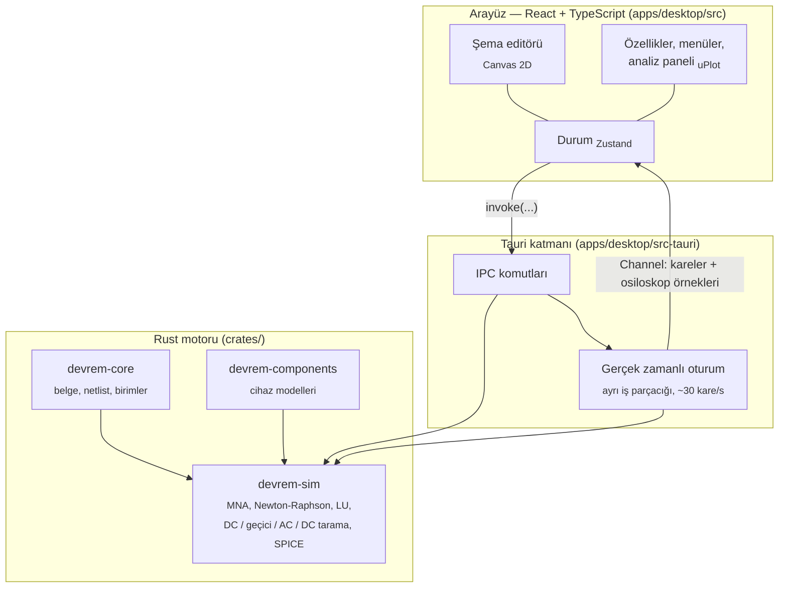

# Devrem Mimarisi

Bu belge Devrem'in iç yapısını, simülasyon motorunun nasıl çalıştığını ve
kod tabanında nerede ne olduğunu anlatır. Katkıda bulunmak isteyenler için
başlangıç noktasıdır.

## Genel Bakış



- **Motor arayüzden bağımsızdır.** `devrem-sim` tek başına bir Rust
  kütüphanesidir; tüm testler arayüz olmadan çalışır.
- **Simülasyon ayrı bir iş parçacığında** koşar; arayüz hiçbir zaman donmaz.
- **Tek bir bileşen tanımı:** pin konumları ve varsayılan özellikler
  `packages/library/components.json` dosyasındadır. Arayüz bu dosyayı doğrudan
  kullanır; Rust tarafındaki tanımın aynı olduğu bir testle doğrulanır.

## Depo Yapısı

```
devrem/
├── crates/
│   ├── devrem-core/          Belge (.dvrm), geometri, SI birimleri, bileşen türleri,
│   │                         netlist üretimi, hata türleri
│   ├── devrem-components/    Cihaz modelleri: diyot / LED / zener, BJT, MOSFET,
│   │                         op-amp, lojik, 555, dalga biçimleri
│   └── devrem-sim/           Simülatör (MNA), LU çözücü, SPICE dışa aktarımı
│       └── tests/            Analitik çözümlerle doğrulama ve örnek devre testleri
├── apps/
│   ├── desktop/
│   │   ├── src/              React arayüzü
│   │   │   ├── editor/       Semboller, çizim, isabet testleri, düzenleme işlemleri
│   │   │   ├── components/   Araç çubuğu, kenar çubuğu, tuval, paneller, galeri
│   │   │   ├── store/        Zustand depoları (editör, simülasyon, ayarlar, osiloskop)
│   │   │   └── lib/          IPC, dosyalar, dışa aktarma, kısayollar, güncelleme
│   │   └── src-tauri/        Tauri komutları ve gerçek zamanlı oturum
│   └── web/                  Next.js tanıtım sitesi (statik)
├── packages/
│   ├── library/              Ortak bileşen tanımları (components.json)
│   └── ui-tokens/            Ortak tasarım token'ları (tokens.css)
├── locales/                  Türkçe ve İngilizce çeviriler
├── examples/                 Örnek devreler (.dvrm)
└── docs/                     Belgeler
```

## Simülasyon Hattı

### 1. Netlist

`devrem-core::Netlist::build` şemayı elektriksel düğümlere çevirir:

1. Tüm pinler ve tel uçları ızgara noktası olarak toplanır.
2. Bir telin **ortasına** denk gelen pin veya tel ucu (T bağlantısı) teli o
   noktada böler.
3. Birbirine bağlı noktalar _union-find_ ile birleştirilir; toprağa bağlı küme
   düğüm 0 olur.
4. Toprak sembolü yoksa ama devrede op-amp veya lojik çıkış gibi toprağa göre
   sürülen bir bileşen varsa, düğüm 0 yine tanımlıdır. Saf analog devrelerde
   toprak zorunludur.

### 2. MNA (Modified Nodal Analysis)

Bilinmeyenler: toprak hariç düğüm gerilimleri ve dal akımları (gerilim
kaynakları, bobinler, ampermetreler, op-amp ve lojik çıkışları, 555 çıkışı).
Her cihaz `G·x = b` sistemine kendi katkısını ekler.

| Cihaz              | Model                                                                        |
| ------------------ | ---------------------------------------------------------------------------- |
| Direnç, lamba      | İletkenlik (lamba: R = V² / P)                                               |
| Kondansatör, bobin | Trapez / geri Euler eşdeğer devresi (geçici durum), jωC / jωL (AC)           |
| Diyot, LED, zener  | Shockley denklemi; zener için ters yönde kırılma terimi                      |
| BJT                | Ebers-Moll taşıma modeli (Is, βF, βR)                                        |
| MOSFET             | Shichman-Hodges seviye 1 (Vth, K, λ); savak/kaynak simetrik                  |
| Op-amp             | Gerilim kontrollü kaynak, `vsat · tanh(A·vd / vsat)` ile yumuşak doyma       |
| Anahtar, buton     | 1 mΩ / 1 TΩ direnç                                                           |
| Lojik çıkış        | 20 Ω iç dirençli 0 / 5 V kaynak                                              |
| 555                | İç 5k–10k bölücü, iki karşılaştırıcı, SR mandal, çıkış katı, deşarj anahtarı |

### 3. Çözüm

- **Newton-Raphson:** doğrusal olmayan cihazlar her iterasyonda çalışma noktası
  etrafında doğrusallaştırılır. Diyot ve BJT jonksiyonlarında SPICE `pnjlim`,
  MOSFET'te adım sınırlama kullanılır.
- **Yakınsama sorunu** olursa _gmin stepping_ ile çözüme kademeli yaklaşılır.
- **Doğrusal sistem:** kısmi pivotlamalı yoğun LU ayrıştırması (gerçek ve
  karmaşık sayılar için ortak, `lu.rs`). Doğrusal devrelerde ayrıştırma
  önbelleğe alınır.
- **Tekil matris** (kısa devre, paralel gerilim kaynakları, açık uçlu akım
  kaynağı) kullanıcıya anlaşılır bir hata olarak döner.

### 4. Analizler

| Analiz             | Nasıl                                                                                                           |
| ------------------ | --------------------------------------------------------------------------------------------------------------- |
| DC çalışma noktası | Kondansatörler açık, bobinler kısa devre                                                                        |
| Geçici durum       | Trapez yöntemi; ilk adımda, anahtarlamadan ve lojik değişimden sonra geri Euler (sayısal salınımı önler)        |
| Gerçek zamanlı     | Her kare (~33 ms) `time_scale` kadar simülasyon süresi ilerletir; 8–400 alt adım, AC/kare dalga frekansına göre |
| AC                 | DC çalışma noktasında doğrusallaştırılmış karmaşık MNA; logaritmik frekans taraması, kazanç (dB) ve faz (°)     |
| DC tarama          | Seçilen DC kaynağın değeri adım adım değiştirilir; her adım bir öncekinin çözümünden başlar                     |

### 5. Dijital Simülasyon

Lojik bileşenler analog motorla aynı matriste çözülür:

- Girişler her zaman adımının başında önceki çözüme göre **2,5 V eşiğiyle** okunur.
- Çıkışlar küçük iç dirençli **0 / 5 V** gerilim kaynaklarıdır.
- Flip-flop'lar yükselen saat kenarında tetiklenir.
- Simülasyon başlarken lojik durum **kenar algılamadan oturtulur**; böylece
  açılışta sahte tetiklenme olmaz.

Bu yaklaşım olay tabanlı bir dijital simülatörden basittir; bedeli, kapı
gecikmesinin zaman adımı kadar olmasıdır. Çok hızlı saatlerde simülasyon
hızını düşürmek gerekir.

### 6. Tel Akımları ve Animasyon

Akım noktalarının her tel parçasında doğru yönde akması için netlist, her
bağlı tel grubunda bir yayılan ağaç kurar. Bileşen pinlerinin akımları
yapraktan köke toplanarak her parçanın akımı bulunur. Toprak ve beslemeli
çıkışlar (op-amp, lojik) kök seçilir; görünmeyen besleme akımı köke akar.

## IPC Komutları

| Komut                                                  | Görevi                                                |
| ------------------------------------------------------ | ----------------------------------------------------- |
| `open_document`, `save_document`                       | `.dvrm` okuma / yazma                                 |
| `sim_start`, `sim_stop`                                | Gerçek zamanlı oturum; kareler bir `Channel` ile akar |
| `sim_set_control`, `sim_set_time_scale`                | Anahtar, buton, lojik giriş, potansiyometre, hız      |
| `sim_dc`, `sim_ac`, `sim_dc_sweep`                     | Tek seferlik analizler                                |
| `export_spice`, `write_text_file`, `write_binary_file` | Dışa aktarma                                          |

## Dosya Formatı (`.dvrm`)

Okunabilir JSON; sürüm kontrolüne uygundur.

```json
{
  "formatVersion": 1,
  "meta": { "name": "RC Şarj", "createdWith": "Devrem 0.1.0" },
  "components": [
    { "id": "R1", "kind": "resistor", "pos": [14, -4], "rot": 0, "props": { "resistance": "10k" } },
    {
      "id": "C1",
      "kind": "capacitor",
      "pos": [20, 0],
      "rot": 1,
      "props": { "capacitance": "100µ" }
    }
  ],
  "wires": [{ "id": "W1", "a": [16, -4], "b": [20, -4] }],
  "simulation": { "timeScale": 1 }
}
```

- Konumlar ızgara birimindedir; `rot` 90° adımlarla saat yönünde dönüştür (0–3).
- Değerler SI önekli metin olarak saklanır (`4k7`, `100n`, `2,2µ`).
- Eksik alanlar varsayılan değerlerle tamamlanır; daha yeni bir format
  sürümüyle kaydedilmiş dosyalar açılırken kullanıcı uyarılır.

## Tasarım Dili

"Karanlık bir laboratuvar masasında parlayan devreler." Uygulama ve web sitesi
aynı token'ları kullanır (`packages/ui-tokens/tokens.css`).

| Token              | Renk      | Kullanım                   |
| ------------------ | --------- | -------------------------- |
| `--bg-base`        | `#0B0E14` | Uygulama arka planı        |
| `--bg-canvas`      | `#0F131A` | Şema alanı                 |
| `--bg-surface`     | `#151A23` | Paneller, kartlar          |
| `--bg-elevated`    | `#1C2230` | Menüler                    |
| `--border`         | `#262E3D` | Kenarlıklar                |
| `--text-primary`   | `#E6EAF2` | Ana metin                  |
| `--text-secondary` | `#8B95A7` | İkincil metin              |
| `--accent`         | `#22D3EE` | Vurgu (elektrik camgöbeği) |
| `--wire`           | `#5B6B85` | Tel (0 V)                  |
| `--current`        | `#FACC15` | Akım noktaları             |
| `--voltage-high`   | `#F43F5E` | Yüksek gerilim             |
| `--voltage-low`    | `#3B82F6` | Negatif gerilim            |
| `--success`        | `#22C55E` | Lojik 1                    |

Yazı tipleri: **Inter** (arayüz) ve **JetBrains Mono** (değerler, kod).

## Testler

- `crates/devrem-sim/tests/analyses.rs` — gerilim bölücü, RC / RL zaman
  sabitleri, diyot ve LED ileri gerilimleri, anahtarlama, AC kaynak, hata durumları
- `crates/devrem-sim/tests/devices.rs` — BJT, MOSFET, op-amp, AC analizi
  (RC filtrede −3 dB / −45°), DC tarama, lojik kapılar, flip-flop'lar
- `crates/devrem-sim/tests/faz3.rs` — potansiyometre, zener, lamba, SPDT,
  kare dalga, 555 frekansı, onaltılık çözücü
- `crates/devrem-sim/tests/examples.rs` — `examples/` klasöründeki her devre
  açılıp simüle edilir ve beklenen değerler kontrol edilir

## Bilinen Sınırlamalar

- **Yoğun LU:** maliyet düğüm sayısının küpüyle artar; yüzlerce düğüme kadar
  akıcıdır. Daha büyük devreler için seyrek (sparse) çözücü planlanıyor.
- **Sabit zaman adımı:** yerel hata kontrolü (LTE) yok; adım, kare süresi ve
  kaynak frekanslarından türetilir.
- **SPICE dışa aktarımı:** lojik bileşenler ve 555 SPICE'a çevrilmez,
  açıklama satırı olarak yazılır. Op-amp doyması SPICE'ta modellenmez.
- **Platform:** şu an yalnızca Windows.
